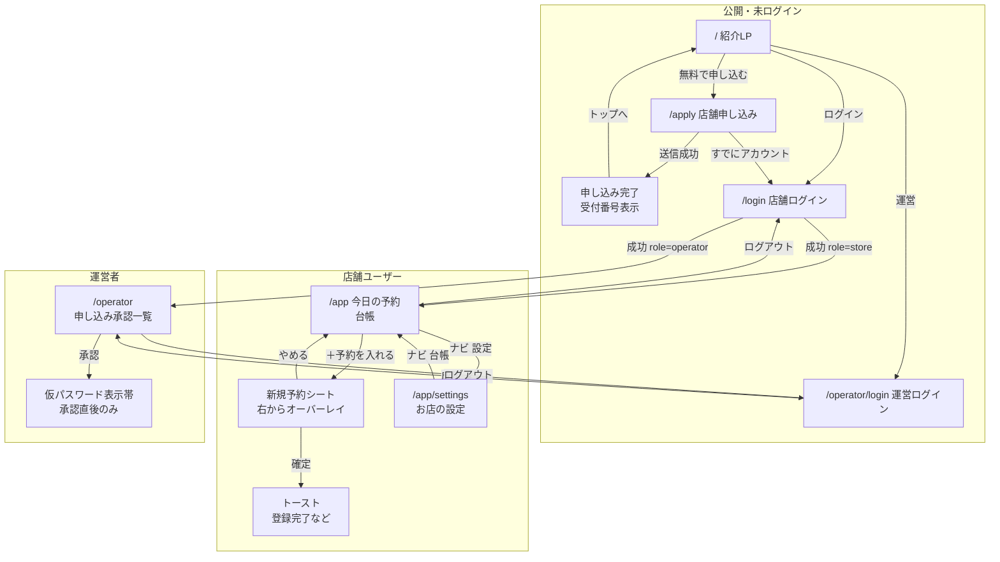
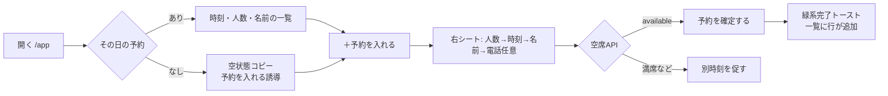
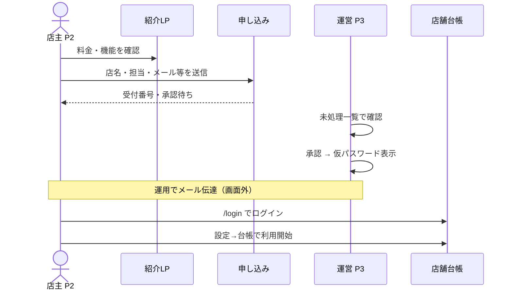

# よやく台帳 — デザイン依頼用ブリーフ

- 対象プロダクト仮称: **よやく台帳**
- 用途: Claude / デザイナーへ渡す画面遷移・画面一覧・制約・トークン
- 関連: `restaurant-ledger-ux-review.md`（競合調査と推奨仕様 R1〜R3）、`document/作りたいもの.md`、`document/市場調査.md`
- 実装の現状: `admin/`（React）。**実装は一覧型台帳**。理想UIは同フォルダの UX レビュー **R1 タイムライン台帳**
- 更新: 2026-11-23（Asia/Tokyo）
- **Claudeデザイン成果物**: [`../design/`](../design/)（`よやく台帳_UIデザイン.html` と `screens-unpacked/`）

---

## 1. プロダクト一言

予約管理システムをまだ入れていない小規模飲食店向けに、**AI電話受付と予約台帳を一体にした SaaS**。紙・Excel から初めてデジタル化する店が、導入・設定・日常操作で迷わないことを最優先する。

**やらないこと（初期）**: グルメサイト一元管理、複雑なフロアマップ配席、POS連携、顧客CRMの深掘り、お客様向け予約Webの装飾。

---

## 2. 利用者（ペルソナ）

| ID | 役割 | 端末 | 主タスク | デザイン上の注意 |
|---|---|---|---|---|
| P1 | 店舗スタッフ／店長 | スマホ〜タブレット、忙しいカウンター | 今夜の予約を一目で見る／電話の合間に手入力 | 文字大きく、タップ大きく、階層を浅く |
| P2 | 店舗管理者 | スマホ or PC | 申し込み・初回設定・営業時間・FAQ | 専門用語を避ける。「初めて」前提 |
| P3 | サービス運営者（制作者） | PC | 申し込みの承認／却下、仮パスワード確認 | 業務ツール。装飾より一覧と状態 |
| P4 | 電話のお客様 | 電話のみ | （画面なし）AIが予約を取る | UI対象外。台帳に「電話」由来として並ぶ |

---

## 3. 画面遷移図

### 3.1 全体（公開〜店舗〜運営）



### 3.2 店舗の主要フロー（日常）



### 3.3 申し込み〜利用開始



---

## 4. ルート／画面一覧（実装ベース）

| 画面ID | パス | 権限 | 目的 | 主要UI |
|---|---|---|---|---|
| S01 | `/` | 公開 | 価値訴求・誘導 | ヒーロー、課題、機能、料金、FAQ、CTA |
| S02 | `/apply` | 公開 | 店舗申し込み | 説明＋フォーム／完了カード |
| S03 | `/login` | 公開 | 店舗ログイン | メール・パスワード、デモヒント |
| S04 | `/app` | 店舗 | 今日の予約台帳 | 日付ナビ、KPI、予約行、＋予約 |
| S05 | （オーバーレイ） | 店舗 | 新規予約 | 右シート、人数・時刻チップ、空席表示 |
| S06 | `/app/settings` | 店舗 | 最小設定 | 基本／営業時間／席確認／FAQ |
| S07 | `/operator/login` | 公開 | 運営ログイン | S03と同型・文言違い |
| S08 | `/operator` | 運営 | 申し込み承認 | フィルタ、カード一覧、承認／却下 |

未ログインで `/app/*` → `/login`。運営が `/app` に来たら `/operator` へ。

---

## 5. 画面ごとのデザイン要件

### S01 紹介LP `/`

**役割**: 就職作品としての入口＋実在する飲食予約SaaS（トレタ等）に近い「申し込みLP」。

**必須コンテンツ（現行）**
- ブランド名「よやく台帳」をヒーロー級に
- 見出し例: 「電話の予約を、台帳にそのまま。」
- CTA: 「無料で申し込む」→ `/apply`、「料金を見る」
- 料金: **基本 3,000円／月（税別）** ＋ **通話 50円／分（税別）**、初期費用0、申し込み時カード不要
- セクション: できることストリップ → お悩み → 機能 → 現場の声 → 料金 → 導入3ステップ → FAQ → 下部CTA
- 右端フロートCTA（デスクトップ）: 「申し込む」

**ビジュアル方針**
- **主ビジュアルは製品UI（タイムライン台帳）**。高級店内のストック写真は使わない（UXレビューでも「写真・木目背景」はアンチパターン）
- 参考イメージ: `gamen/img/toreta_web_Daicho_*.png`（競合製品の構図参考。自社UIとして描き直すこと）
- トーン: 明るい業務SaaS。紫グラデ／クリーム＋テラコッタのAI定番見た目は避ける
- 現行実装のLP色: ティール `#0F766E` 系ヘッダー＋オレンジ CTA `#F97316`（変更可だが「飲食予約SaaS」感は維持）

**デバイス**: モバイル優先。デスクトップは2カラムヒーロー可。

---

### S02 申し込み `/apply`

**レイアウト**: 左＝説明＋料金箇条書き、右＝フォーム（モバイルは縦積み）。

**フォーム項目**

| 項目 | 必須 | 例 |
|---|---|---|
| 店舗名 | ○ | 食堂さくら |
| 担当者名 | ○ | |
| メール | ○ | ログインIDになる |
| 電話 | ○ | |
| 補足メモ | × | |

**状態**
- 送信中: ボタン disabled
- エラー: 必須欠け／メール形式／通信失敗
- 完了: 「受け付けました」＋受付番号＋トップへ

---

### S03 / S07 ログイン

- 中央カード。店舗は「店舗向け予約台帳」、運営は「運営者」表記
- フィールド: メール、パスワード
- 店舗ログイン下リンク: 申し込み・紹介へ
- エラー文言は業務向け短文（「メールまたはパスワードが違います」等）

---

### S04 今日の予約 `/app`（現状＝リスト／目標＝R1）

#### 現状（実装）

```
┌────────────────────────────────────────┐
│ 今日の予約          [＋ 予約を入れる]   │
│ 店名チップ                              │
├────────────────────────────────────────┤
│ ‹ 11月21日（金） ›  [今日] [更新]       │
│ ┌予約 n組┐ ┌人数合計┐ ┌利用時間分┐     │
│ 18:00  (4)  田中 様  卓A  [手入力]      │
│ 18:30  (2)  山田 様  卓B  [電話]        │
└────────────────────────────────────────┘
ナビ: 台帳 | 設定 | ユーザー | ログアウト
```

- 時刻は大きく、人数は丸、名前は太字
- ソースバッジ: `電話`（ai_phone）／`手入力`
- 空状態: 「この日の予約はまだありません」＋誘導文

#### 目標デザイン（`restaurant-ledger-ux-review.md` R1）

**iPad横向きタイムライン**を理想とする（就職作品の見せ場）。

- 左ナビ（台帳／設定など）＋卓列＋時間グリッド
- 予約は横バー: 人数丸 → 名前 → 状態テキスト
- 来店前＝白地＋青枠、着席＝緑塗り、現在時刻＝赤縦線
- 詳細は右シート（台帳を隠さない）
- トークン・レイアウト寸法は同MD **§11.4.1 / R1** を正とする

デザイン成果物では **「MVPリスト版」と「目標タイムライン版」を両方**出してよい。実装優先はリスト、作品展示用にタイムライン案が欲しい。

---

### S05 新規予約シート

- 右からスライド（幅おおよそ 380〜420px、モバイルはほぼ全幅）
- 台帳は背面に残す（薄暗く）
- 入力順: **人数チップ(1–6)** → **時刻チップ** → **名前** → **電話任意**
- 7名以上は「スタッフ対応」注記（確定不可）
- 空席結果をその場表示（空いている／満席／定休など）
- フッター: やめる｜予約を確定する（必須＋空き時のみ活性）
- 確定後: 一覧側で分かる完了（緑トースト推奨）。入力画面と完了を混同させない（競合の悪い例）

---

### S06 お店の設定

4ブロックのみ（これ以上増やさない）:

1. **基本** … 店名、標準利用時間チップ（60/90/120/150/180分）
2. **営業時間** … 曜ごと 営業/休み＋開始・終了
3. **席（AI予約枠）** … 表示中心。AI予約OK／当日客用バッジ（編集は将来）
4. **FAQ** … 電話AIが読む Q&A。追加・削除

ヘッダー右に「保存する」。保存成功トースト。

---

### S08 運営 申し込み承認

- フィルタチップ: 未処理／承認済／却下／すべて
- 1申し込み＝1カード: 店名、担当、メール、電話、メモ、日時、状態
- アクション: 承認／却下（却下は任意理由）
- 承認直後: **仮パスワードを画面上に大きく表示**（この画面でのみ）。閉じられるバナー
- 装飾よりスキャナビリティ優先

---

## 6. デザインシステム（依頼時の初期値）

実装・UXレビューを踏まえた推奨。LPとアプリでトーンを揃えてよいが、**台帳は情報密度、LPは訴求**で強弱を変える。

### 6.1 色（アプリ／台帳 — UXレビュー準拠）

| トークン | HEX | 用途 |
|---|---|---|
| bg/app | `#F7F7F5` | 背景 |
| bg/surface | `#FFFFFF` | 面 |
| text/strong | `#1C1917` | 名前・数字 |
| text/muted | `#78716C` | 補足 |
| brand/primary | `#2563EB` | 主ボタン・来店前枠 |
| status/seated | `#16A34A` | 着席・成功 |
| now-line | `#E11D48` | 現在時刻 |
| alert | `#DC2626` / `#FEF3C7` | エラー／注意 |

### 6.2 色（公開LP — 現行）

| 用途 | HEX |
|---|---|
| ヘッダー／帯 | `#0F766E`〜`#0D9488` |
| CTA | `#F97316` |
| 本文 | `#1C1917` / `#78716C` |

### 6.3 タイポ・触るサイズ

- 日本語: Noto Sans JP / Zen Kaku Gothic New など（Inter・Roboto・Arial避け）
- 数字: `tabular-nums`
- 最小タップ: **44×44pt**
- チップ・主ボタンは指で押しやすい高さ（48〜52px目安）

### 6.4 避けること

- 紫オン白／紫インディゴのAI定番グラデ
- 暗いシネマティックLP、Three.jsのための抽象背景
- 店内写真・木目をフロアマップやヒーローの主アンカーにすること
- カードの乱用（操作単位以外）
- アイコンのみナビ（必ずラベル）
- 凡例のない多色（状態色は最大おおよそ5段階）

---

## 7. コピー・料金（確定表示）

| 項目 | 文言 |
|---|---|
| 製品名 | よやく台帳 |
| 基本料 | 3,000円／月（税別） |
| 通話 | 50円／分（税別）。1分未満は1分。通話なしの月は0 |
| 初期費用 | なし |
| 申し込み時カード | 不要 |
| 導入 | フォーム → 運営承認 → メールでログイン |

FAQ例（LP）:
- すぐ使える？ → 承認後にログイン可
- カード必要？ → 不要
- 電話と手入力は別画面？ → 同じ台帳。電話はバッジで判別

---

## 8. デバイス別優先度

| 成果物 | 優先 |
|---|---|
| LP・申し込み・ログイン | **モバイル 390幅** → デスクトップ 1280 |
| 台帳リスト版（MVP） | モバイル＋タブレット |
| 台帳タイムライン版（目標） | **iPad横 1024〜1366** |
| 運営承認 | デスクトップ／タブレット |

---

## 9. 依頼してほしい成果物チェックリスト

1. [ ] 全体の画面遷移図（本MDの更新版で可）
2. [ ] S01 LP（モバイル＋デスクトップ）1セット
3. [ ] S02 申し込み（入力／完了）
4. [ ] S03 ログイン
5. [ ] S04 台帳 **リスト版**（空／数件入り）
6. [ ] S04 台帳 **タイムライン版ワイヤー or ハイファイ**（R1）
7. [ ] S05 予約シート（人数・時刻選択、空き／満席）
8. [ ] S06 設定（4ブロック）
9. [ ] S08 運営一覧＋承認後パスワード帯
10. [ ] コンポーネント: ボタン、チップ、バッジ（電話／手入力）、トースト、空状態
11. [ ] カラー／タイプのトークン表

---

## 10. Claude への短い依頼文（コピペ用）

```text
「よやく台帳」のUIデザインをお願いします。
入力は gamen/doc/design-handoff.md と gamen/doc/restaurant-ledger-ux-review.md（特に §11.4 と R1）です。

条件:
- 小規模飲食店のスタッフがピーク時に使える業務UI。AIっぽい抽象デザインにしない
- 公開LPの主ビジュアルは店内写真ではなくタイムライン台帳の製品UI
- 料金は基本3000円/月＋通話50円/分を明記
- まずモバイルのLP・申し込み・ログイン・リスト台帳・予約シート、次にiPad横のタイムライン台帳案
- 画面遷移は design-handoff.md の mermaid に従う
- 避けるもの（紫グラデ、木目写真背景、アイコンのみナビ）も同MDどおり

出力: 各画面のレイアウト説明、主要コンポーネント、カラー、必要ならASCIIまたは構造化ワイヤー。
```

---

## 11. 参考ファイル

| パス | 内容 |
|---|---|
| `gamen/doc/restaurant-ledger-ux-review.md` | 競合UI調査・推奨R1〜R3・トークン |
| `gamen/img/` | 競合スクショ（構図参考。自社デザインに転用時は描き直し） |
| `gamen/img/SOURCES.md` | 画像出典 |
| `document/作りたいもの.md` | 企画・ターゲット・機能境界 |
| `document/市場調査.md` | 紙・電話・競合の根拠 |
| `admin/src/pages/*` | 現行実装画面 |
